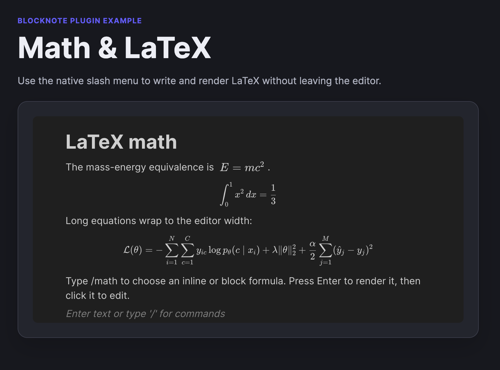

# BlockNote Math

A BlockNote React extension for writing LaTeX with [KaTeX](https://katex.org/).
It provides compact inline formulas and a native slash-menu command for
full-width equation blocks. The original LaTeX source is preserved in exported
HTML for round-trip paste support.

## Example


## Install

```sh
npm install @defensestation/blocknote-math katex
```

The host application owns the KaTeX version and imports both stylesheets once:

```ts
import "katex/dist/katex.min.css";
import "@defensestation/blocknote-math/styles.css";
```

## Use

Add both supplied schema specs and register the Equation slash-menu item.

```tsx
import { BlockNoteSchema, defaultBlockSpecs, defaultInlineContentSpecs } from "@blocknote/core";
import {
  getDefaultReactSlashMenuItems,
  SuggestionMenuController,
  useCreateBlockNote,
} from "@blocknote/react";
import { BlockNoteView } from "@blocknote/mantine";
import {
  getMathSlashMenuItems,
  latexInlineContentSpecs,
  mathBlockSpecs,
} from "@defensestation/blocknote-math";
import { filterSuggestionItems } from "@blocknote/core/extensions";
import "katex/dist/katex.min.css";
import "@defensestation/blocknote-math/styles.css";

const schema = BlockNoteSchema.create({
  blockSpecs: {
    ...defaultBlockSpecs,
    ...mathBlockSpecs,
  },
  inlineContentSpecs: {
    ...defaultInlineContentSpecs,
    ...latexInlineContentSpecs,
  },
});

function Editor() {
  const editor = useCreateBlockNote({ schema });
  const getSlashMenuItems = async (query: string) =>
    filterSuggestionItems(
      [
        ...getDefaultReactSlashMenuItems(editor),
        ...getMathSlashMenuItems(editor),
      ],
      query,
    );

  return (
    <BlockNoteView editor={editor} slashMenu={false}>
      <SuggestionMenuController triggerCharacter="/" getItems={getSlashMenuItems} />
    </BlockNoteView>
  );
}
```

Type `/math`, then select **Inline equation** or **Block equation**. Write TeX
in the focused field and press Enter or click away to render it.

## Edit a formula

Click an inline or display formula to open its compact LaTeX editor. The formula
updates live in the document while you type. Enter or click away applies a valid
equation, Shift+Enter adds a line, and Escape cancels.

## Package contents

- `latexInlineContentSpecs`: inline formula schema entry.
- `mathBlockSpecs`: full-width equation-block schema entry.
- `getMathSlashMenuItems`: native `/math` menu items for inline and block equations.
- `@defensestation/blocknote-math/styles.css`: plugin UI styles.

## Publishing

Run `npm run typecheck` and `npm run build` before publishing.
